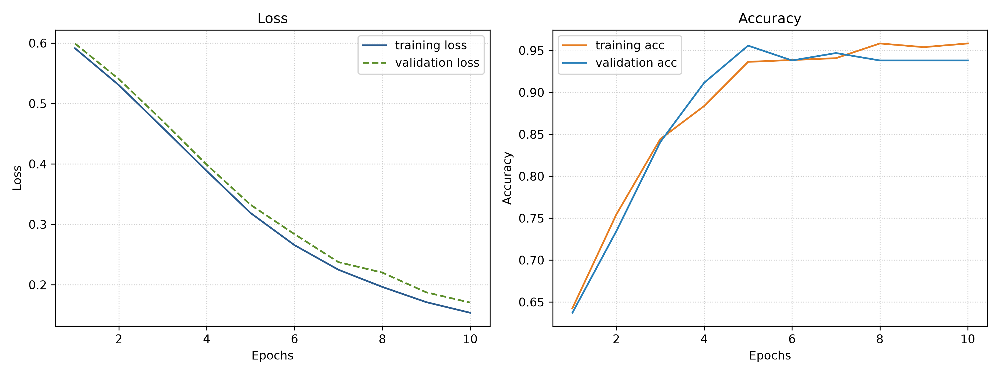
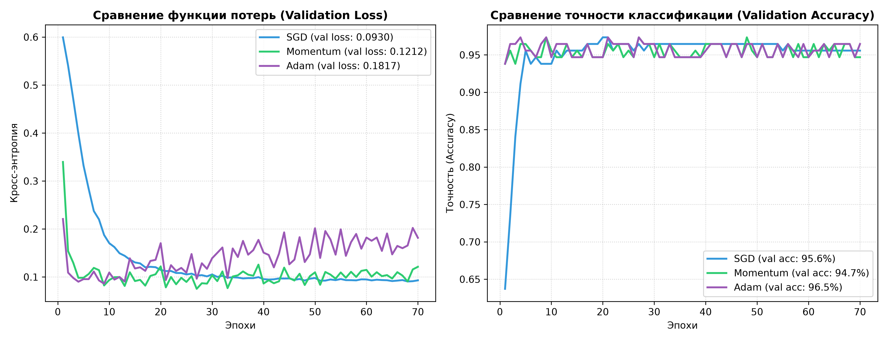

# Многослойный персептрон (Multilayer Perceptron from Scratch)

[](https://www.python.org/)
[](https://opensource.org/licenses/MIT)
[](https://numpy.org/)

Реализация полносвязной искусственной нейронной сети (многослойный персептрон) **с нуля на чистом NumPy** (без использования PyTorch, TensorFlow, Keras, scikit-learn) для решения задачи бинарной классификации клеток опухолей молочной железы (**Wisconsin Diagnostic Breast Cancer, WDBC**).

---

## 📌 Ключевые особенности

- **Векторная математика на чистом NumPy**:
  - Прямой проход ($Z = X W + b, A = g(Z)$);
  - Обратное распространение ошибки (**Backpropagation**) через цепное правило (Chain Rule);
  - Матричные вычисления оптимизированы под мини-батчи без лишних циклов.
- **Модульная архитектура (`mlp/`)**:
  - Настраиваемое количество скрытых слоев и нейронов (по умолчанию 2 скрытых слоя по 24 нейрона);
  - Функции активации: `sigmoid`, `relu`, `leaky_relu`, `tanh`;
  - Выходной слой: **Softmax** с численной стабилизацией ($z - \max(z)$) для формирования вероятностного распределения по классам;
  - Функция потерь: **Binary Cross-Entropy** с аналитическим градиентом $dZ^{[L]} = \hat{Y} - Y$.
- **Алгоритмы оптимизации (градиентный спуск)**:
  - `SGD` (Mini-Batch Gradient Descent);
  - `Momentum` (метод тяжелого шарика с инерцией $\beta = 0.9$);
  - `Adam` (адаптивная оценка моментов 1-го и 2-го порядка с коррекцией смещения).
- **Инициализация весов**:
  - `He Uniform` (автоматически выбирается для ReLU / LeakyReLU);
  - `Xavier Uniform` (автоматически выбирается для Sigmoid / Tanh / Softmax).
- **Предобработка данных без Data Leakage**:
  - **Class-conditional mean imputation**: пропуски в обучающих данных заполняются средним значением соответствующего класса ($\mu_{c, j}$), при инференсе — глобальным средним ($\mu_{\text{global}, j}$);
  - **Z-score стандартизация** ($z = (x - \mu)/\sigma$): параметры масштабирования вычисляются строго на Train и упаковываются в архив модели вместе с весами.
- **Стратификация при разбиении**:
  - Скрипт `split.py` сохраняет исходный баланс классов (62.7% Benign / 37.3% Malignant) в обучающей и проверочной выборках.

---

## 📂 Структура проекта

```
Perceptron/
│
├── mlp/                            # Ядро нейронной сети
│   ├── __init__.py                 # Пакетная инициализация
│   ├── activations.py              # Функции активации (Sigmoid, ReLU, LeakyReLU, Tanh, Softmax)
│   ├── layers.py                   # Слой DenseLayer (веса W, смещения b, forward, backward)
│   ├── losses.py                   # Функции потерь (Binary и Categorical Cross-Entropy)
│   ├── metrics.py                  # Точность, матрица ошибок, Precision, Recall, Specificity, F1
│   ├── network.py                  # MultiLayerPerceptron (обучение, сохранение/загрузка .npz)
│   ├── optimizers.py               # Алгоритмы оптимизации (SGD, Momentum, Adam)
│   └── preprocessing.py            # DatasetPreprocessor (импутация, Z-score стандартизация)
│
├── plots/                          # Графики обучения и исследовательского анализа данных
│   ├── eda_class_distribution.png
│   ├── eda_correlation_heatmap.png
│   ├── eda_feature_distributions.png
│   ├── learning_curves.png
│   └── optimizers_comparison.png
│
├── split.py                        # Разделение датасета на train (80%) и validation (20%)
├── train.py                        # Обучение нейросети с визуализацией кривых
├── predict.py                      # Прогнозирование и расчет метрик на тестовом наборе
├── mlp.py                          # Единый командный интерфейс для всех этапов
├── eda.py                          # Исследовательский статистический анализ данных
├── test_pipeline.py                # Сквозные автотесты пайплайна
│
├── data.csv                        # Исходный набор данных Wisconsin Breast Cancer
├── data_training.csv               # Обучающая выборка (456 строк)
├── data_validation.csv             # Проверочная выборка (113 строк)
├── .gitignore                      # Исключение временных файлов и кэша
└── README.md                       # Документация проекта
```

---

## 🚀 Установка и запуск

### 1. Подготовка окружения
Рекомендуется использовать Python 3.11+:
```powershell
# Создание и активация виртуального окружения
python -m venv venv
.\venv\Scripts\Activate.ps1

# Установка зависимостей (NumPy, Pandas, Matplotlib, Seaborn)
pip install numpy pandas matplotlib seaborn
```

---

### 2. Исследовательский анализ данных (EDA)
```powershell
python eda.py
```
Скрипт анализирует распределения признаков, баланс классов, строит матрицу корреляций и сохраняет графики в папку `plots/`.

---

### 3. Разделение датасета
```powershell
python split.py
```
*Вывод:*
```text
Data split: 456 train -> data_training.csv, 113 valid -> data_validation.csv
```

---

### 4. Обучение модели (`train.py`)

**Базовый запуск (2 скрытых слоя по 24 нейрона, Sigmoid, SGD):**
```powershell
python train.py
```

**Кастомный запуск с гибкой настройкой гиперпараметров:**
```powershell
python train.py --layer 32 32 --epochs 80 --batch_size 8 --learning_rate 0.0314 --activation relu --optimizer adam
```

**Доступные аргументы:**
- `--layer` — размеры скрытых слоев (по умолчанию: `24 24`);
- `--epochs` — количество эпох обучения (по умолчанию: `70`);
- `--batch_size` — размер мини-батча (по умолчанию: `8`);
- `--learning_rate` — скорость обучения (по умолчанию: `0.0314`);
- `--activation` — функция активации: `sigmoid`, `relu`, `leaky_relu`, `tanh`;
- `--optimizer` — алгоритм оптимизации: `sgd`, `momentum`, `adam`;
- `--model_out` — путь для сохранения обученной модели (по умолчанию: `saved_model.npz`).

---

### 5. Прогнозирование и оценка качества (`predict.py`)
```powershell
python predict.py
```
*Вывод на проверочном наборе данных (113 пациентов):*
```text
loss: 0.0931 - accuracy: 0.9558 (108/113)
```

---

### 6. Единая точка входа (`mlp.py`)
Все этапы можно выполнять через главный интерфейс:
```powershell
python mlp.py split
python mlp.py train --layer 24 24 --epochs 70 --activation sigmoid --optimizer sgd
python mlp.py predict
```

---

## 📊 Результаты и визуализация

### Кривые обучения (SGD, Sigmoid, 84 эпохи)


Функция потерь монотонно снижается без расхождения кривых валидации, что свидетельствует об отсутствии переобучения.

---

### Итоговые метрики качества на проверочном наборе (113 пациентов)

| Метрика | Значение | Интерпретация |
|---|---|---|
| **Binary Cross-Entropy Loss** | **0.0931** | Отличная сходимость функции потерь |
| **Accuracy (Общая точность)** | **95.58%** | 108 из 113 пациентов классифицированы верно |
| **Recall (Полнота для рака)** | **97.62%** | **41 из 42 злокачественных опухолей выявлены** |
| **Precision (Точность прогноза)** | **91.11%** | 91.1% предсказанных раковых клеток подтвердились |
| **Specificity (Специфичность)** | **94.37%** | 67 из 71 доброкачественных подтверждены |
| **F1-Score** | **0.9425** | Высокий гармонический баланс Precision и Recall |

#### Матрица ошибок (Confusion Matrix)
```text
                   Предсказано: Здоров (0)    Предсказано: Рак (1)
Истинно: Здоров (0)        67 (TN)                    4 (FP)
Истинно: Рак (1)            1 (FN)                   41 (TP)
```
> В онкодиагностике ключевой является ошибка **False Negative** (пропуск заболевания). Модель допустила всего **1 ошибку FN на 113 пациентов**, достигнув полноты **Recall = 97.62%**.

---

### Сравнение алгоритмов оптимизации


| Оптимизатор | Train Loss | Validation Loss | Train Accuracy | Validation Accuracy |
|---|---|---|---|---|
| **SGD** | 0.0494 | **0.0930** | 98.68% | 95.58% |
| **Momentum** | 0.0227 | 0.1212 | 99.12% | 94.69% |
| **Adam** | **0.0160** | 0.1817 | **99.78%** | **96.46%** |

- **SGD** обеспечивает наилучшую калибровку вероятностей и минимальный лосс на валидации;
- **Momentum** быстрее преодолевает пологие плато за счет накопления кинетической энергии градиента;
- **Adam** обеспечивает наивысшую точность классификации (96.46%) благодаря индивидуальным адаптивным шагам для каждого параметра.

---

## 🧪 Тестирование
Для проверки корректности математического ядра, заполнения пропусков и сквозного обучения предусмотрен скрипт автотестов:
```powershell
python test_pipeline.py
```
```text
--- ТЕСТ 1: Проверка заполнения пропусков по классам ---
[УСПЕХ] Заполнение пропусков по среднему значению класса работает безупречно!

--- ТЕСТ 2: Полный сквозной пайплайн (split -> train -> predict) ---
loss: 0.2518 - accuracy: 0.9558 (108/113)
[УСПЕХ] Сквозной пайплайн отработал отлично!
```
